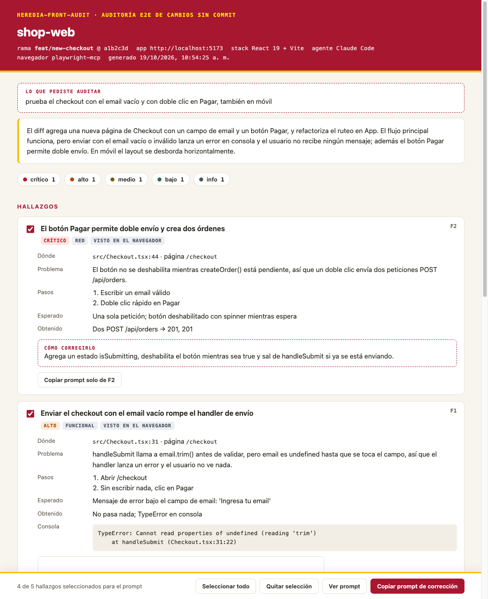

# heredia-front-audit

**Auditoría de tus cambios de frontend antes de hacer commit, para Claude Code y Codex.**

Escribes `/heredia-front-audit` (Claude Code) o `$heredia-front-audit` (Codex) en tu proyecto. El
agente lee lo que cambiaste y todavía no tiene commit, prueba la app en un navegador real como lo
haría un QA exigente, revisa el código y abre un reporte HTML en español con los problemas
encontrados, cómo corregirlos, la repetición paso a paso de cada prueba y un botón
**Copiar prompt de corrección** para pegarle al agente.



---

## En resumen

```bash
# 1. Una sola vez, en cualquier terminal:
npx github:Ai-team-testing-grounds/heredia-front-audit

# 2. Cada vez que quieras auditar, en la carpeta de tu proyecto:
claude          # y dentro escribe:  /heredia-front-audit
codex           # o, si usas Codex:  $heredia-front-audit
```

Eso es todo. El reporte se abre solo en tu navegador.

¿Quieres que pruebe algo en concreto? Descríbelo después del comando, con tus palabras:

```text
/heredia-front-audit prueba el login con una contraseña incorrecta y luego crea una tarea
```

---

## Contenido

- [Qué hace](#qué-hace)
- [Instalación (una sola vez)](#instalación-una-sola-vez)
- [Uso](#uso)
- [Lista de comandos](#lista-de-comandos)
- [Según tu tipo de proyecto](#según-tu-tipo-de-proyecto)
- [El reporte](#el-reporte)
- [El navegador: Claude Code y Codex](#el-navegador-claude-code-y-codex)
- [Instalarlo para todo el equipo en un proyecto](#instalarlo-para-todo-el-equipo-en-un-proyecto)
- [Problemas frecuentes](#problemas-frecuentes)
- [Para quien mantiene la herramienta](#para-quien-mantiene-la-herramienta)

---

## Qué hace

- **Prueba lo que cambiaste o lo que le pidas**: los flujos que tocan tus cambios sin commit, o el
  flujo que describas con tus palabras, no toda la app.
- **Navegador real**: flujo principal, casos límite, vista móvil (375px), errores de consola,
  llamadas de red fallidas o duplicadas y accesibilidad básica.
- **Evidencia de lo probado**: una captura después de cada paso. En el reporte, cada flujo tiene un
  botón **▶ Ver pasos** que reproduce la prueba paso a paso.
- **Revisión de código**: condiciones de carrera, estados de carga/error faltantes, XSS, CSRF,
  código de depuración olvidado (`console.log`, `dd()`, `var_dump`…), y más.
- **Ciclo de corrección**: marcas los hallazgos, copias el prompt, lo pegas en el agente y vuelves a
  auditar para verificar.
- **No toca tu código**: nunca edita ni hace commit. Solo escribe en `.heredia-front-audit/`, que se
  ignora en git automáticamente.
- **Cualquier stack**: React, Next, Vue, Nuxt, Angular, Svelte, Laravel, Symfony, WordPress, PHP
  plano, sitios estáticos, Rails, Django… y monolitos con el frontend en una subcarpeta.
- **No agrega nada a tu proyecto**: no instala paquetes npm ni composer.

## Instalación (una sola vez)

Necesitas:

- **Node.js 18.17 o superior** y **git** (aunque tu proyecto sea PHP: Node solo ejecuta los
  pequeños scripts de la herramienta). Comprueba con `node -v` y `git --version`.
- **Claude Code** y/o **Codex** instalados y con sesión iniciada.
- **Google Chrome** (lo usa el navegador automático).

Luego, en cualquier terminal:

```bash
npx github:Ai-team-testing-grounds/heredia-front-audit
```

Este comando:

1. Instala el comando en cada agente que encuentre (Claude Code y/o Codex), para **todos** tus
   proyectos.
2. Le da al agente un navegador (registra **Playwright MCP**). Si ya lo tenías, lo deja igual.

Después **cierra y vuelve a abrir** Claude Code / Codex. Para actualizar a una versión nueva,
ejecuta el mismo comando otra vez.

<details>
<summary>Otras formas de instalar</summary>

| Quiero… | Comando |
|---|---|
| Solo Claude Code | `npx github:Ai-team-testing-grounds/heredia-front-audit --claude` |
| Solo Codex | `npx github:Ai-team-testing-grounds/heredia-front-audit --codex` |
| Sin registrar Playwright | agrega `--no-playwright` |
| Sin npx | `git clone https://github.com/Ai-team-testing-grounds/heredia-front-audit && node heredia-front-audit/bin/heredia-front-audit.mjs` |
| Desinstalar | `npx github:Ai-team-testing-grounds/heredia-front-audit uninstall` |
| Como plugin de Claude Code (incluye el navegador) | dentro de Claude Code: `/plugin marketplace add Ai-team-testing-grounds/heredia-front-audit` y luego `/plugin install heredia-front-audit@heredia-front-audit` (no lo combines con el instalador) |

</details>

## Uso

1. Haz tus cambios en el proyecto y **no hagas commit**.
2. Abre una terminal en la carpeta del proyecto y abre tu agente (`claude` o `codex`).
3. Escribe el comando:

| | Claude Code | Codex |
|---|---|---|
| Normal | `/heredia-front-audit` | `$heredia-front-audit` |
| Indicando la URL de la app | `/heredia-front-audit http://localhost:5173` | `$heredia-front-audit http://localhost:5173` |
| Describiendo qué auditar | `/heredia-front-audit prueba el formulario de pago en móvil` | `$heredia-front-audit prueba el formulario de pago en móvil` |

### Describir qué quieres auditar

Después del comando puedes escribir, con tus palabras, el flujo que quieres que pruebe: los pasos,
los datos y lo que esperas que pase. No hacen falta comillas, y la URL puede ir en cualquier parte.

```text
/heredia-front-audit prueba el login con una contraseña incorrecta: debe salir un mensaje de error y no entrar
/heredia-front-audit http://mi-proyecto.test entra con el usuario de prueba, crea una tarea, márcala como hecha y bórrala
/heredia-front-audit revisa que el formulario de contacto funcione en móvil y que no se pueda enviar vacío
```

| ¿Tienes cambios sin commit? | ¿Describiste un flujo? | Qué audita |
|---|---|---|
| Sí | No | Los flujos que tocan tus cambios. |
| Sí | Sí | Primero lo que describiste, tal cual lo pediste; después el resto de flujos que tocan tus cambios. |
| No (o el proyecto no usa git) | Sí | Solo lo que describiste, y revisa el código de esas pantallas. |
| No (o el proyecto no usa git) | No | Te pregunta qué flujo quieres auditar. |

Lo que pediste aparece arriba del reporte, en **Lo que pediste auditar**.

Lo que pasa:

1. **Contexto**: un script reúne la rama, los archivos cambiados y el diff, y crea una carpeta para
   esta auditoría.
2. **Plan**: empieza por lo que describiste (si describiste algo) y agrega las pantallas y flujos
   que afectan tus cambios.
3. **App**: usa tu URL, la de la auditoría anterior, o busca/arranca el servidor de desarrollo (y lo
   detiene al terminar si lo arrancó él).
4. **Pruebas en el navegador**, con una captura por paso.
5. **Revisión del código** cambiado.
6. **Reporte**: lo genera y lo abre en tu navegador.

Si el agente te pregunta algo (la URL, un usuario de prueba), respóndele en el chat: solo lo
pregunta una vez.

## Lista de comandos

### Instalar (en la terminal, una sola vez)

```bash
# Claude Code y Codex (los que tengas instalados) + navegador Playwright MCP. Recomendado.
npx github:Ai-team-testing-grounds/heredia-front-audit

# Solo Claude Code
npx github:Ai-team-testing-grounds/heredia-front-audit --claude

# Solo Codex
npx github:Ai-team-testing-grounds/heredia-front-audit --codex

# Sin registrar el navegador Playwright MCP
npx github:Ai-team-testing-grounds/heredia-front-audit --no-playwright

# Dentro del proyecto actual, para hacer commit y compartirlo con el equipo
npx github:Ai-team-testing-grounds/heredia-front-audit --project

# Actualizar a la última versión: el mismo comando de instalación otra vez
npx github:Ai-team-testing-grounds/heredia-front-audit

# Desinstalar
npx github:Ai-team-testing-grounds/heredia-front-audit uninstall
```

Después de instalar o actualizar, **cierra y vuelve a abrir** Claude Code / Codex.

<details>
<summary>Alternativa: instalar como plugin de Claude Code (no lo combines con el instalador)</summary>

Dentro de Claude Code:

```text
/plugin marketplace add Ai-team-testing-grounds/heredia-front-audit
/plugin install heredia-front-audit@heredia-front-audit
```

El plugin ya incluye el navegador Playwright: no hay que configurar nada más. Como plugin, el comando completo es `/heredia-front-audit:heredia-front-audit` (también funciona
`/heredia-front-audit` si ningún otro comando usa ese nombre). Para actualizar:
`/plugin marketplace update heredia-front-audit`. Codex no tiene plugins para esto: usa el
instalador con `npx`.

</details>

### Usar (dentro de Claude Code o Codex)

| Para… | Claude Code | Codex |
|---|---|---|
| Auditar tus cambios sin commit | `/heredia-front-audit` | `$heredia-front-audit` |
| Indicar la URL de la app | `/heredia-front-audit http://localhost:5173` | `$heredia-front-audit http://localhost:5173` |
| Auditar un flujo que describes | `/heredia-front-audit prueba el login con contraseña incorrecta` | `$heredia-front-audit prueba el login con contraseña incorrecta` |
| URL + flujo | `/heredia-front-audit http://mi-proyecto.test crea una tarea y bórrala` | `$heredia-front-audit http://mi-proyecto.test crea una tarea y bórrala` |
| Instalado como plugin | `/heredia-front-audit:heredia-front-audit` + lo mismo de arriba | — |
| Buscarlo en el menú | escribe `/` y busca `heredia-front-audit` | `/skills` → **Heredia Front Audit** |
| Verificar después de corregir | vuelve a ejecutar `/heredia-front-audit` | vuelve a ejecutar `$heredia-front-audit` |

### Ciclo de corrección

1. En el reporte, marca los hallazgos y presiona **Copiar prompt de corrección**.
2. Pégalo en el chat de Claude Code o Codex y deja que corrija.
3. Ejecuta otra vez `/heredia-front-audit` (o `$heredia-front-audit`) para verificar.

### Comandos útiles (en la terminal)

```bash
codex mcp list                   # Codex: ver si el navegador "playwright" está registrado
claude mcp list                  # Claude Code: lo mismo (dentro de Claude Code también: /mcp)

open .heredia-front-audit/latest.html    # macOS: abrir el último reporte
start .heredia-front-audit\latest.html   # Windows: abrir el último reporte

# Sin abrir el chat (CI o scripts): auditar y generar el reporte directamente
claude -p "/heredia-front-audit http://localhost:3000"
codex exec 'Usa el skill $heredia-front-audit con http://localhost:3000'
```

## Según tu tipo de proyecto

| Tu proyecto | Qué tienes que hacer |
|---|---|
| **Frontend independiente** (React, Vue, Angular, Svelte, Vite, Next…) | Nada. Detecta el framework y usa o arranca `npm run dev` / `ng serve`. |
| **Monolito o monorepo** (el frontend está en `frontend/`, `web/`, `apps/…`) | Nada. Detecta la carpeta de la app a partir de los archivos que cambiaste. Puedes abrir el agente en la raíz del repo. |
| **Laravel / Symfony** | Si usas `php artisan serve` o `symfony serve`, lo arranca él (y `npm run dev` si las páginas cargan sin CSS/JS). Nunca ejecuta migraciones ni seeders sin preguntar. |
| **PHP en Laragon, XAMPP, WAMP, MAMP, Valet o Herd** (incluye WordPress) | Prueba las URLs típicas (`http://<carpeta>.test`, `http://localhost/<carpeta>`). Si no la encuentra, pásale la URL la primera vez: `/heredia-front-audit http://mi-proyecto.test`. **Las siguientes veces la recuerda.** |
| **App con login** | Te pide un usuario de prueba una vez. Usa uno de prueba, nunca tu contraseña real. |

Para cada stack revisa lo que más suele fallar: dependencias de efectos e hidratación en React/Vue,
suscripciones en Angular, salida sin escapar (`{!! !!}`, `|raw`, `echo` sin `htmlspecialchars`),
CSRF, validación, asignación masiva y consultas N+1 en PHP.

## El reporte

- Los hallazgos van ordenados por severidad (**crítico → info**); haz clic en una severidad para
  filtrar.
- Cada hallazgo indica dónde está (archivo:línea y página), qué está mal, cómo reproducirlo, qué se
  esperaba y qué pasó, la salida de consola, una captura y **cómo corregirlo**.
- **Flujos probados**: cada flujo tiene **▶ Ver pasos**, una repetición de las capturas tomadas
  después de cada acción, con lo que hizo el agente y si ese paso pasó o falló. Es la evidencia de lo
  que realmente se probó.
- Marca los hallazgos que quieres corregir (los que no son "info" vienen marcados), presiona
  **Copiar prompt de corrección** y pégalo en Claude Code o Codex. Cada hallazgo tiene además su
  propio botón, y **Ver prompt** muestra exactamente lo que vas a pegar.
- Después de corregir, vuelve a ejecutar `/heredia-front-audit` para verificar.

Cada auditoría se guarda en tu repo (sin aparecer en `git status`):

```
.heredia-front-audit/
  latest.html                      ← siempre el último reporte
  runs/2026-10-09_17-30-02/
    findings.json                  ← resultados estructurados
    report.html                    ← reporte autocontenido (capturas incluidas)
    fix-prompt.md                  ← el mismo prompt que copia el botón
    screenshots/<flujo>/01-….png   ← una captura por paso
```

## El navegador: Claude Code y Codex

Los dos agentes usan **Playwright MCP**, que el instalador registra por ti. Abre su propia
ventana de Chrome, limpia y separada de tu Chrome personal. **No tienes que activar nada más**, ni
extensiones ni opciones de Chrome.

Si el agente no tiene navegador, igual revisa el código y en el reporte te explica cómo activarlo
(normalmente basta con volver a ejecutar el instalador).

<details>
<summary>Avanzado: usar tu propio Chrome en vez de Playwright</summary>

No hace falta para el uso normal. Si Playwright no está disponible, la herramienta puede usar
Claude in Chrome en Claude Code (la [extensión de Claude](https://chromewebstore.google.com/detail/claude/fcoeoabgfenejglbffodgkkbkcdhcgfn)
y `claude --chrome`). En Codex, la extensión de Chrome solo existe en la app de escritorio, no en
la CLI ([documentación](https://learn.chatgpt.com/docs/chrome-extension)).

</details>

## Instalarlo para todo el equipo en un proyecto

Si prefieres que el comando venga incluido en un repo (para que quien lo clone ya lo tenga):

```bash
cd tu-proyecto
npx github:Ai-team-testing-grounds/heredia-front-audit --project
git add .claude/skills/heredia-front-audit .agents/skills/heredia-front-audit
git commit -m "Agregar /heredia-front-audit"
```

## Problemas frecuentes

**No tengo cambios sin commit**: describe el flujo que quieres probar:
`/heredia-front-audit prueba el registro de usuarios`. Si no describes nada, te pregunta qué
auditar. Si quieres auditar lo que ya subiste en el último commit, `git reset --soft HEAD~1` lo
devuelve a cambios sin commit sin perder nada.

**No aparece `/heredia-front-audit`**: cierra y vuelve a abrir Claude Code / Codex después de
instalar. En Codex también puedes buscarlo en `/skills`.

**El agente no tiene navegador**: vuelve a ejecutar el instalador y reinicia el agente. Para
comprobarlo: en Claude Code escribe `/mcp` (debe aparecer `playwright`); en Codex ejecuta
`codex mcp list`.

**No encuentra mi app (PHP con Laragon/XAMPP/etc.)**: pásale la URL una vez:
`/heredia-front-audit http://mi-proyecto.test`. Queda recordada para las siguientes auditorías.

**Codex no puede arrancar o abrir el servidor**: el sandbox de Codex puede bloquearlo. Aprueba el
comando cuando te lo pida, o arranca tú el servidor y pásale la URL.

**El reporte no se abrió**: ábrelo tú: `.heredia-front-audit/latest.html`.

**Cambios muy grandes**: dile qué revisar: `/heredia-front-audit solo la página de configuración`.

---

## Para quien mantiene la herramienta

### Publicarla para el equipo

1. `node scripts/set-owner.mjs <usuario-u-organización> "Tu Nombre"` (una vez).
2. Sube el repo a GitHub. Puede ser privado: `npx github:…` funciona si cada persona tiene acceso al
   repo con su git (SSH o credenciales de GitHub).
3. Comparte la sección [En resumen](#en-resumen) con el equipo.

### Personalizar

Las instrucciones del agente están en **`src/`** y son compartidas por los dos agentes:

| Archivo | Qué es |
|---|---|
| `src/workflow.md` | El procedimiento de QA (pasos 1–8) y el formato de `findings.json`. Edítalo para agregar los chequeos de tu equipo. |
| `src/claude-code.md` | Frontmatter de Claude Code y cómo se inyecta el contexto. |
| `src/codex.md` | Frontmatter de Codex y el paso "ejecuta collect-context primero". |

Después de editar ejecuta `npm run build` (regenera `skills/heredia-front-audit/SKILL.md`) y vuelve
a instalar. El `SKILL.md` de Codex se genera al instalar porque necesita la ruta real.

- Nuevo stack: agrega una regla en `skills/heredia-front-audit/scripts/detect-stack.mjs` y una línea
  de checklist en el paso 5 de `src/workflow.md`.
- Diseño y colores del reporte: `skills/heredia-front-audit/templates/report.html`.
- `HEREDIA_FRONT_AUDIT_MAX_DIFF_LINES` (por defecto `2500`): cuánto diff se incluye antes de truncar.
- `HEREDIA_FRONT_AUDIT_NO_OPEN=1` o `--no-open`: no abrir el reporte automáticamente.

### Estructura

```
heredia-front-audit/
├── .claude-plugin/                 ← hace de este repo un marketplace de plugins de Claude Code
├── skills/heredia-front-audit/     ← el skill
│   ├── SKILL.md                    ← GENERADO desde src/ con `npm run build`
│   ├── scripts/
│   │   ├── collect-context.mjs     ← diff/estado de git + stack → Markdown; crea la carpeta de la auditoría
│   │   ├── detect-stack.mjs        ← detecta stack, URL y comando de arranque (cualquier framework)
│   │   └── render-report.mjs       ← findings.json → report.html + fix-prompt.md, y lo abre
│   └── templates/report.html
├── src/                            ← instrucciones (fuente única para los dos agentes)
├── bin/heredia-front-audit.mjs     ← instalador (Claude Code + Codex + Playwright MCP)
├── scripts/build.mjs               ← genera SKILL.md por agente
├── scripts/set-owner.mjs           ← una vez: completa tu usuario de GitHub / nombre
├── examples/demo-run/              ← datos de ejemplo (`npm run demo`)
├── frontend/                       ← app de prueba: login + dashboard (`cd frontend && npm run dev`)
└── test/run.mjs                    ← pruebas (`npm test`, en CI con Linux/macOS/Windows)
```

### Desarrollo

```bash
npm test                # pruebas sin dependencias
npm run build           # regenerar SKILL.md después de editar src/
npm run demo            # generar y abrir el reporte de ejemplo
node bin/heredia-front-audit.mjs   # instalar tu copia de trabajo
```

Haz commit del `SKILL.md` regenerado junto con cualquier cambio en `src/`: CI falla si no coinciden.

## Licencia

[MIT](LICENSE)
